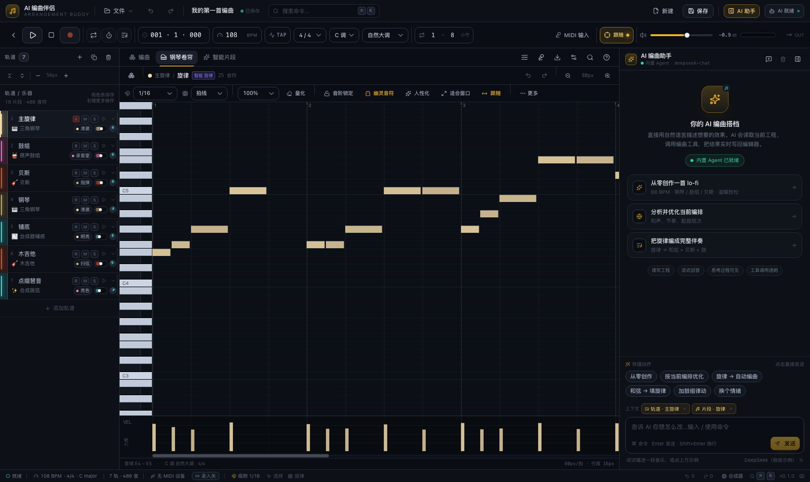
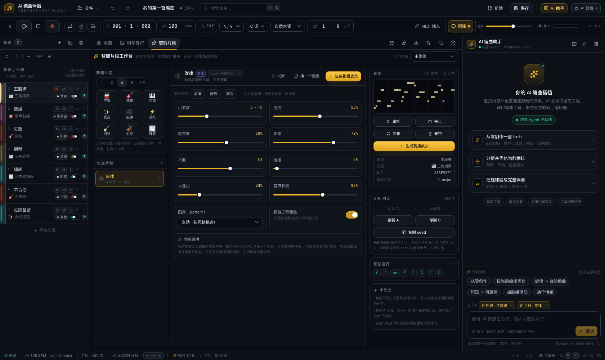
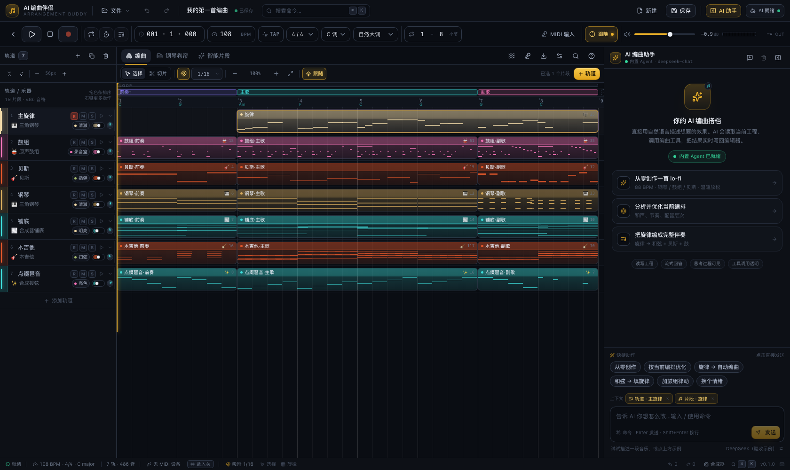
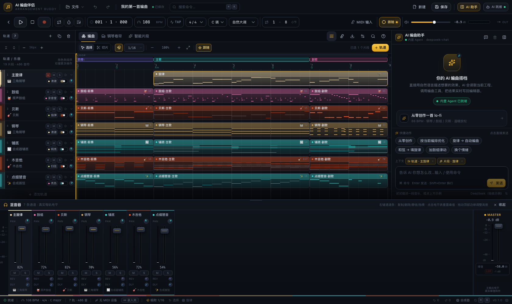
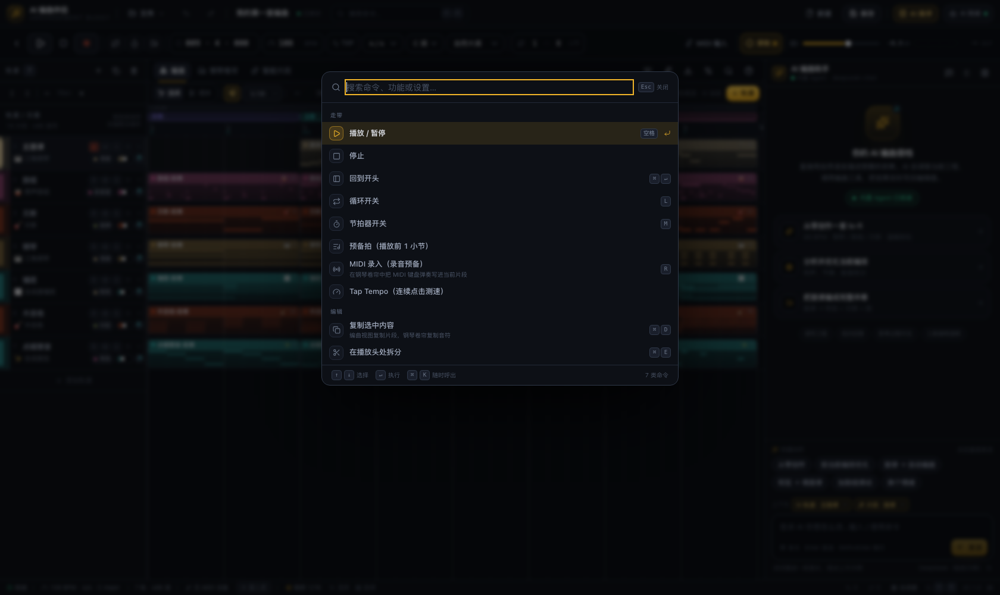
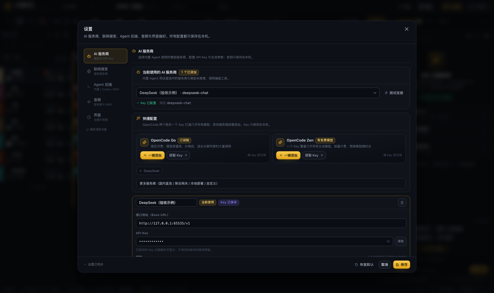
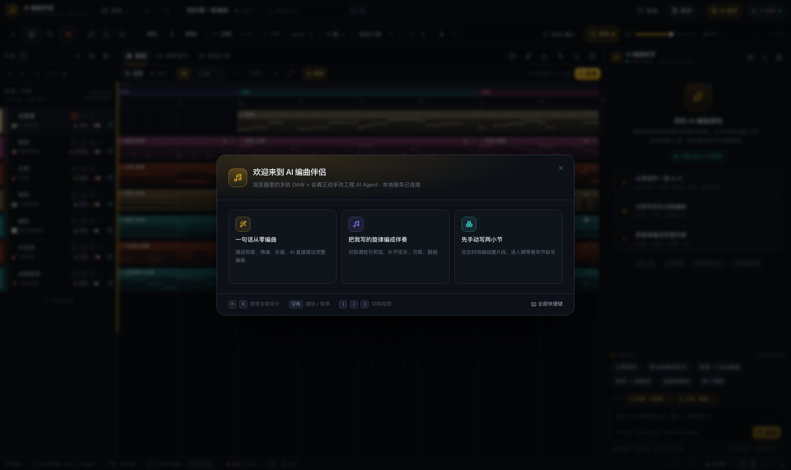
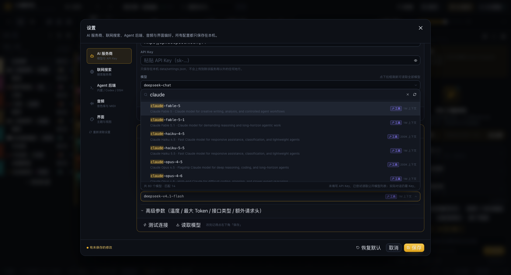

# 🎼 AI 编曲伴侣 · AI Arrangement Buddy

> **浏览器里的专业编曲工作站 + 真正会动手的 AI 编曲 Agent。**
> 多轨钢琴卷帘、智能片段、MIDI 键盘、高保真乐器与情绪、以及能思考 / 调工具 / 联网的 AI —— 全部跑在你自己的电脑上。

一个给作曲人用的「AI 编曲副驾驶」：你写旋律或和弦，它配编曲；你描述想要的情绪，它直接改你眼前的工程。
支持 **Docker 一键部署**，也支持 **macOS / Windows 双击即用**（自动安装所需环境，不需要 Docker、不需要命令行知识）。

| 编曲视图（多选 / 工具条 / 专业轨道头） | 钢琴卷帘（音阶锁定 / 幽灵音符 / 右键菜单） |
| --- | --- |
|  |  |

| 智能片段 | AI 助手（真实工具调用） |
| --- | --- |
|  |  |

| 混音器（真实每轨电平 / dB 标尺） | 命令面板（⌘K 搜索全部命令） |
| --- | --- |
|  |  |

| 设置（AI 服务商 / Agent） | 首次使用引导 |
| --- | --- |
|  |  |

> 截图来自真实运行的本应用（headless Chrome 自动截取），不是设计稿。
> 本次界面交互升级的对标分析与施工记录见 [docs/UI_UX_UPGRADE.md](docs/UI_UX_UPGRADE.md)。


---

## 目录

- [它解决什么问题](#它解决什么问题)
- [功能一览](#功能一览)
- [三种启动方式](#三种启动方式)
  - [方式一：Docker（推荐给 NAS / 服务器）](#方式一docker推荐给-nas--服务器)
  - [方式二：macOS 双击启动](#方式二macos-双击启动)
  - [方式三：Windows 双击启动](#方式三windows-双击启动)
  - [方式四：开发者命令行](#方式四开发者命令行)
- [配置 AI](#配置-ai)
  - [接入大模型 API](#1-接入大模型-api)
  - [Agent 后端：内置 / Codex CLI / DeepSeek Harness](#2-agent-后端内置--codex-cli--deepseek-harness)
  - [联网搜索](#3-联网搜索)
  - [外部 Agent 反过来驱动本应用（MCP）](#4-外部-agent-反过来驱动本应用mcp)
- [音色与乐器](#音色与乐器)
- [使用指南](#使用指南)
- [快捷键](#快捷键)
- [架构](#架构)
- [数据与隐私](#数据与隐私)
- [常见问题](#常见问题)
- [许可与致谢](#许可与致谢)

---

## 它解决什么问题

编曲最耗时的不是写旋律，而是「把想法变成一个能听的完整编排」：
配和声、铺弦乐、写鼓组、调音色、加情绪、反复试错。AI 编曲伴侣把这部分变成可撤销、可微调、可协作的过程：

- **你有旋律** → 它识别调性、配和弦、铺一整套伴奏（古典/摇滚/电子三种编制思路）
- **你有和弦** → 它写旋律，可指定情绪、密度、音域
- **什么都没有** → 一句话描述想法，它从零搭出一首 16 小节编曲
- **已有工程** → 它读你的编排，按你的要求增删声部、换音色、改节奏

而且 AI 的每一次改动都**直接落在工程里**（不是甩给你一段文字），你可以继续用钢琴卷帘手动改，也可以一键撤销。

---

## 功能一览

| 能力 | 说明 |
| --- | --- |
| **多轨编曲** | 无限轨道，每轨独立乐器、情绪、音量、声像、混响/延迟发送、静音/独奏；轨道头含录入预备 R、真实电平、行高拖拽、右键菜单 |
| **时间轴编辑** | 选择 / 切片工具、吸附网格、缩放至适合、跟随播放头；多选片段整体移动、⌘D 复制、Alt 拖拽复制、方向键微移、右键菜单、点击空白定位播放头 |
| **钢琴卷帘** | Canvas 高性能编辑：绘制、拖拽、改时值、框选、缩放、力度条、量化（50/75/100% 强度）、移调、吸附网格、**音阶锁定**、**幽灵音符**、**右键音符菜单**、人性化、适合窗口 |
| **智能片段** | Logic Pro 风格生成器：节奏 / 低音 / 和弦 / 琶音 / 旋律 / 动机 / 扫弦 / 对位 / 铺底，参数可实时调、一键换变奏、参数预设、A/B 对比、生成到播放头 |
| **智能片段（情绪）** | 每个乐器 4–6 种情绪（温暖 / 明亮 / 忧郁 / 激昂 / 张力 / 宏大…），映射到真实的音色与演奏法（断奏、闷音、震音、泛音、拨奏） |
| **和弦进行补全（P7-C）** | 智能片段面板「补全进行」：给半截罗马数字进行（如 `I V vi`）+ 目标长度（4/8/16），按风格/最后和弦功能补全后半段，展示终止式与原因；一键写入工程和弦（跟随和弦的智能片段自动重算，⌘Z 一步撤销） |
| **简谱导入（P7-D）** | 文件菜单「导入简谱…」：粘贴简谱（`1=C`、`4/4`、`♩=120`、1–7 音符、`'`/`,` 八度、`#`/`b`、`/` 八分、`.` 附点、`-` 延长、`~` 连音、`\|` 小节线）→ 生成单条旋律轨；可再接「AI 重编（cover）」渲染成完整歌 |
| **一键整曲 + 分轨（P7-E）** | 生成面板「一键整曲 + 分轨 Stem」：选乐器（吉他/贝斯/鼓/弦乐/键盘/合成器/人声，默认 3 种）+ 质量模式 → 先出整曲音频轨，再以整曲为上下文逐条生成 Stem 落独立轨道；面板内显示每步进度，每步独立撤销 |
| **本机引擎自动安装（P8）** | 首次启动检测平台（Windows x64 / macOS Apple Silicon / Linux x64），自动下载 ACE-Step 运行时（官方 GitHub release）与模型（公开 HF，sha256 校验、断点续传、按需 profile：基础≈3.4GB / +质量≈7.6GB / +分轨≈10.2GB）；自动附带自生成数据的 LoRA 适配器（jrpg_v1/jrpg_v2/jrock_v1，≈81MB，GitHub Releases 校验安装）；顶栏「安装本机引擎」或 `node scripts/provision.mjs`；macOS 用 Metal 后端。详见 [docs/SETUP_MAC.md](docs/SETUP_MAC.md) |
| **MIDI 键盘** | Web MIDI 直连、热插拔；可直接弹奏当前轨道音色试听，打开「录入」开关后弹奏会写入钢琴卷帘（支持音阶锁定） |
| **AI 编曲 Agent** | 真正的思考链 + 37 个工具 + 联网搜索；三种后端可切换。除生成/分析外还能**编辑已有编配**：复制/重复片段与段落、拆分/合并、量化、整体或片段移调、人性化、力度曲线、音阶锁定、复制/清空轨道、摇摆/拍号/循环区间；也能通过 `ui_action` 直接驱动界面（播放/停止/跳转/切视图/打开导出/撤销重做）。AI 面板支持停止生成、重新生成、Slash 命令、上下文引用、窄条折叠 |
| **命令面板** | ⌘K 搜索并执行全部命令（走带 / 编辑 / 视图 / 轨道 / 工程 / AI / 帮助），与快捷键帮助同源 |
| **旋律 → 编曲** | 自动识别调性、配和弦、生成整套伴奏（不依赖 AI Key，本地算法也能跑） |
| **和弦 → 旋律** | 按和弦进行 + 情绪参数生成旋律 |
| **风格 · 用途向导** | 新建工程两步：9 个风格（含 **J-Rock / JRPG 配乐**）→ 11 个用途场景（战斗 / BOSS / 地牢 / 城镇 / 世界地图 / 剧情悲伤 / 片尾 / 日摇 OP / 副歌 / 抒情 / 通用 BGM），自动带调性、速度、段落骨架，并落盘 `style`/`scene` |
| **和弦进行灵感** | 智能片段面板「换一组进行」：按当前风格/调性给 5 条带描述与节奏提示的进行，一键写入工程、可撤销 |
| **MIDI 导入** | 文件 → 导入 MIDI：解析 SMF format 0/1（多通道分轨、鼓轨单列、running status），导入后可直接让 AI 配伴奏 |
| **创作信息** | 时间轴和弦轨 + 轨道头「风格 · 用途 · 调式 · BPM · 段落」摘要 + 只读创作信息弹层（乐器、智能片段参数、seed、跟随和弦） |
| **导出** | MIDI（.mid）、WAV、MP3、FLAC、OGG；支持全曲 / 循环区间、预计大小与时长 |
| **混音器** | 真实每轨电平、dB 标尺、峰值保持与重置、推子加速度拖拽、通道右键菜单、高度可拖拽 |
| **AI 混音（推子 + 每轨链 + 母线/母带）** | 按「声部角色 × 风格 × 能量」自动给每轨音量/声像/混响与延迟发送 + 总线；可同时应用每轨三段 EQ + 压缩 + 补偿增益（合成器/音频片段/SoundFont 采样全覆盖；采样轨 >16 条时回退全局输出）以及**总线 / 母带处理**（总线 EQ + 母线压缩 + 限幅上限 -1dBFS）；先预览差异再一键应用，⌘Z 一步撤销，可分别清除每轨链/母带链 |
| **音频轨道（P1/P2）** | 导入 WAV → 音频轨 + 波形片段，随走带播放（与 Tone.Transport 同步，复用轨道音量/声像/静音/发送）；支持选中、右键删除、双击定位；右键「局部重绘…」按区间重绘（整段替换为新 take，原版本保留、可「切换版本」回退）；`stretchRatio` 固定 1（暂不做变速） |
| **AI 重编 / cover（P7-B）** | 生成面板「AI 重编（cover）」：把当前工程离线渲染成 WAV（含每轨链/母线链）→ 上传资产 → cover 任务（保结构换编制）→ 新音频轨；「贴近原结构」滑杆 0–1（默认 0.7），不改原 MIDI。适用场景：MIDI 编好骨架后让 AI 渲染成完整歌，再迭代加轨/重绘 |
| **生成分轨 Stem（P5）** | 音频片段右键「生成分轨 Stem…」：按乐器（吉他/贝斯/鼓组/弦乐/键盘/合成器/人声，可多选）各提交一个 lego 任务（base 基座），完成后自动新建独立音频轨并对齐源片段位置。**注意：stem 是按原曲上下文独立生成的，不是分离音轨，不保证与源音频逐样本对齐或相加还原** |
| **AI 生成音频（P1/P2/P7）** | 顶栏「生成音频」→ 描述/BPM/时长/风格/LoRA 适配器 → 由本地 Companion 调 ACE-Step 生成，进度条 + 可取消，完成后自动上轨（一次撤销）。**质量模式**（P7-A）：勾选后走 `LM → sft 50 步`（更慢、高频/编曲更完整，与 LoRA 互斥，20s 音频约 15–25s）。适配器含自生成数据的 `jrpg_v1/v2`、`jrock_v1`，以及**真实数据内部研究版** `real_jrpg_v1` / `real_jrock_v1`（用户提供商业录音训练，仅本地研究、不得分发；A/B 对比页在 `music-gen/lora-data/ab/<tag>/listen.html`） |
| **Companion 工作节点（P2/P4）** | GPU 机器上运行 `node scripts/companion.mjs --server <服务地址> --acestep --engine-idle 600`：常驻引擎跨任务复用（冷启动 15s → 热任务 2s）、按任务切换 turbo/sft、支持 LoRA、真取消（杀引擎后自动恢复）、repaint 执行器；P4 起上报真实模型能力并支持任务优先级（普通/高/紧急）与排队位置/ETA |
| **任务中心（P4）** | 顶栏「任务中心」：队列概览（普通/高/紧急）、任务状态/进度/优先级/排队位置/预计等待、取消排队或运行中任务、完成后定位产物；生成/重绘面板可直接选优先级 |
| **同步 / NAS（P6）** | `POST /api/sync/export` / `import`：`.aiabsync` 真 ZIP 包（工程 + 资产 + manifest sha256）；资产按内容去重、工程冲突生成「同步副本」不覆盖；`GET /api/sync/status` 检查 NAS 挂载与占用；CLI `node scripts/sync.mjs export/import/status`。详见 [docs/SYNC.md](docs/SYNC.md) |
| **多段压缩 + 侧链（P6）** | AI 混音面板新增「三段总线压缩」（低/中/高各自压缩后合并）与「侧链 ducking」（默认鼓组压贝斯）；导出 WAV 时离线重建每轨链 + 母线链，与实时一致 |
| **VST3 插件（P6）** | DAW 瘦客户端形态：服务端 `/api/vst3/*` 桥接已实现并验收（提交/轮询/取消/产物下载 + 能力协商）；`plugin/` 提供 JUCE 8 脚手架与设计文档。本机无 cmake/MSVC，**未编译验证**。详见 [docs/VST3_PLUGIN.md](docs/VST3_PLUGIN.md) |
| **专业界面** | 深色录音棚风格，琥珀金点缀，走带 / 时间码 / 电平表 / 混音器齐备；可拖拽面板、首次使用引导、可搜索快捷键帮助、reduced-motion 适配 |
| **响应式布局** | 1024–1920px 宽度自动适配：走带按宽度单/双行、混音器全宽底栏、工具条分档收纳、窄屏标签栏图标化；`pnpm audit:ui` 在 5 种宽度 × 11 个界面状态下自动检查文字裁剪 / 遮挡 / 溢出 |

---

## 三种启动方式

### 方式一：Docker（推荐给 NAS / 服务器）

```bash
git clone <本仓库> ai-arrangement-buddy
cd ai-arrangement-buddy
docker compose up -d
```

打开 <http://127.0.0.1:8787> 即可。

- 数据（工程 / 设置 / 音色库）保存在命名卷 `aiab-data`，容器重建不丢
- 改端口：`AIAB_PORT=9000 docker compose up -d`
- 看日志：`docker compose logs -f`
- 镜像内含 ffmpeg，支持导出 MP3 / FLAC / OGG
- 容器内使用 Codex CLI 需要额外挂载与权限，默认关闭（见 [Agent 后端](#2-agent-后端内置--codex-cli--deepseek-harness)）

手动构建：

```bash
docker build -t ai-arrangement-buddy:latest .
docker run -d --name aiab -p 8787:8787 -v aiab-data:/data ai-arrangement-buddy:latest
```

### 方式二：macOS 双击启动

1. 解压 / 克隆本仓库
2. 双击 **`start-macos.command`**

首次运行会自动：检测 Node.js（缺则下载官方 LTS 到项目内 `.runtime/`，**不需要管理员密码**）→ 安装依赖 → 启动并打开浏览器。

如果系统提示「无法打开，因为来自身份不明的开发者」：右键 → 打开 → 打开；或在终端里执行一次：

```bash
chmod +x start-macos.command scripts/bootstrap-node.sh
xattr -dr com.apple.quarantine .
```

生产模式（速度更快、占用更低）：

```bash
./start-macos.command --prod
```

### 方式三：Windows 双击启动

1. 解压本仓库
2. 双击 **`start-windows.bat`**

首次运行会自动：检测 Node.js（缺则用 PowerShell 下载官方 LTS 解压到项目内 `.runtime\node`，**不需要管理员权限**）→ 安装依赖 → 启动并打开浏览器。

> 如果双击后窗口一闪而过，请在 PowerShell 里手动执行 `powershell -ExecutionPolicy Bypass -File scripts\bootstrap-node.ps1`，再重试。
> 也可以直接安装 <https://nodejs.org/zh-cn/download> 的 LTS 版本后双击。

### 方式四：开发者命令行

```bash
pnpm install
pnpm dev            # 前端 http://127.0.0.1:5183 ，后端 http://127.0.0.1:8787
```

生产构建与运行：

```bash
pnpm build
pnpm start          # 单端口 http://127.0.0.1:8787
```

其他脚本：

```bash
pnpm typecheck      # 全量 TypeScript 检查（core / server / web）
pnpm test           # 后端接口冒烟测试（12 项）
pnpm e2e            # 真实浏览器端到端验收（需先 pnpm build，会自动截图到 .verify/）
pnpm verify         # 构建 + 接口冒烟 + 端到端，一条命令全量验收
pnpm audit:ui       # 布局审计：1024/1120/1280/1440/1680 × 11 个界面状态，检测文字裁剪/遮挡/溢出（截图到 .audit/）
pnpm soundfonts     # 下载开源音色库（可选，40MB）
```

> 端到端验收会用 headless Chrome 真实操作界面：检查示例工程、三种视图、钢琴卷帘写入/撤销、
> 9 类智能片段生成、走带、WAV 离线渲染、导出格式、设置页分区、MIDI 导出，并用 mock AI 服务商
> 验证「AI 对话 → 工具调用 → 工程被修改」全链路。截图输出在 `.verify/`。

---

## 配置 AI

打开右上角 **⚙ 设置**。所有配置只保存在你本机（`data/settings.json`），不会上传。

### 1. 接入大模型 API

在「AI 服务商」里选一个预设，填 API Key 即可。内置预设：

| 服务商 | Base URL | 说明 |
| --- | --- | --- |
| **OpenCode Go** | `https://opencode.ai/inference/go/openai/v1` | 订阅制（$10/月起），含 Kimi / GLM / DeepSeek / Qwen / MiniMax 等 28 个模型 |
| **OpenCode Zen** | `https://opencode.ai/zen/v1` | 按量付费网关，含 GPT-5.x / Claude / Gemini，还有一批**免费模型** |
| DeepSeek | `https://api.deepseek.com/v1` | 中文强、工具调用稳、便宜（推荐） |
| OpenAI | `https://api.openai.com/v1` | 通用能力均衡 |
| Anthropic Claude | `https://api.anthropic.com` | 长文本与描述能力强 |
| Moonshot Kimi | `https://api.moonshot.cn/v1` | 长上下文 |
| 通义千问 | `https://dashscope.aliyuncs.com/compatible-mode/v1` | 国内直连 |
| 智谱 GLM | `https://open.bigmodel.cn/api/paas/v4` | 国内直连 |
| SiliconFlow | `https://api.siliconflow.cn/v1` | 多模型聚合 |
| OpenRouter | `https://openrouter.ai/api/v1` | 一个 Key 用所有模型 |
| Ollama（本地） | `http://127.0.0.1:11434/v1` | 完全离线，Key 随便填 |
| 自定义 | 任意 OpenAI 兼容端点 | vLLM / LM Studio / one-api… |

点「测试连接」可验证 Key 与模型是否可用（显示延迟）。

**模型怎么选？** 配置卡片里的「模型」是一个可搜索的下拉框：
- 点开后自动读取该服务商的 `/models` 接口，列出**全部可用模型**，支持输入关键字过滤（如 `claude`、`free`、`qwen`）
- 每个模型后面会标注 **上下文长度 / 是否支持工具调用（AI 编曲必需）/ 是否免费**
- 也支持直接手打任意模型 ID（服务商没提供列表时用）
- OpenCode Go / Zen 的模型列表是公开的，**没填 Key 也能先看能选哪些模型**



设置页顶部有「快捷配置」：**OpenCode Go / OpenCode Zen 一键添加**（含获取 Key 的直达链接），
其余服务商（DeepSeek / 千问 / Kimi / 智谱 / SiliconFlow / OpenRouter / Ollama / 自定义）收在「更多服务商」里，
不占版面。已添加的服务商会显示为独立配置卡片：Base URL、API Key（可显示/清除/脱敏保留）、模型选择器、
高级参数（温度 / 最大 Token / 接口类型 / 模型列表地址 / 额外请求头）分层收纳。

> **不配置 Key 也能用**：旋律→编曲、和弦→旋律、智能片段生成、播放、编辑、导出全部是本地能力。

### 2. Agent 后端：内置 / Codex CLI / DeepSeek Harness

设置 →「Agent」里切换：

| 后端 | 说明 | 需要什么 |
| --- | --- | --- |
| **内置 Agent**（默认） | 应用自带的 function-calling 循环：多轮思考、调用 DAW 工具、联网搜索 | 一个 API Key |
| **Codex CLI** | 把编曲当成一个「编程任务」交给本机 `codex exec`，通过 MCP 把自己的 DAW 工具暴露给 Codex，Codex 可以读代码、跑命令、查资料、再回来改你的工程 | 已安装并登录 `codex`（`npm i -g @openai/codex`） |
| **DeepSeek Harness** | 接入本机 DSH Agent CLI（若可用）；不可用时明确提示并回退到内置 Agent，不会假装成功 | 本机可用的 `dsh` 可执行文件 |

设置页会实时显示探测结果（可用 ✓ / 不可用 ✗）。装配说明见 [`docs/AGENT.md`](docs/AGENT.md)。

### 3. 联网搜索

| Provider | 需要 Key | 说明 |
| --- | --- | --- |
| DuckDuckGo | ❌ 不需要 | 默认，开箱即用（抓取 HTML 结果） |
| Tavily | ✅ | 面向 AI 的搜索 API，质量最好 |
| Brave Search | ✅ | 独立索引 |
| Serper | ✅ | Google 结果代理 |

AI 在需要参考资料（如「查一下 90 年代 City Pop 的典型和声进行」）时会自动调用搜索工具。

### 4. 外部 Agent 反过来驱动本应用（MCP）

本项目内置 **MCP Server**，把「创建轨道 / 写音符 / 编曲 / 查乐理」等能力暴露为标准 MCP 工具。
这意味着 Codex CLI、DeepSeek Harness、Claude Code、Cursor 等任何支持 MCP 的 Agent，都能直接操作这个 DAW。

```bash
# 启动 MCP server（stdio）
node apps/server/dist/mcp.mjs
```

在 Codex 里注册：

```bash
codex mcp add aiab -- node /绝对路径/apps/server/dist/mcp.mjs
```

详见 [`docs/AGENT.md`](docs/AGENT.md)。

---

## 音色与乐器

应用内置 **32 种乐器**，分五大类，每种带 4–6 个情绪预设：

- **古典 / 管弦（14）**：三角钢琴、弦乐群、独奏小提琴、大提琴、低音提琴、长笛、单簧管、双簧管、圆号、小号、竖琴、定音鼓、合唱、管风琴
- **摇滚 / 流行（7）**：电钢琴、木吉他、电吉他、失真吉他、爵士吉他、贝斯、摇滚风琴
- **电子（5）**：合成器铺底、合成器主音、合成拨弦、合成器贝斯、琶音合成器
- **鼓组（3）**：原声鼓组、爵士鼓、电子鼓机（含 808）
- **色彩 / 世界（3）**：马林巴、钢片琴、卡林巴

每个乐器的「情绪」不是换名字，而是真实的演奏法差异：弦乐「紧张」= 高把位 + 快颤音 + 弓压；
吉他「闷音」= 低通 + 短促 + 拨弦音头；钢琴「忧郁」= 慢起音 + 长尾 + 更多混响。

**两套发声引擎，自动择优：**

1. **内置合成器**（默认可用）：按每个乐器的音色配方（分层振荡器 + 滤波包络 + 效果链）实时合成，零下载、零延迟。
2. **SoundFont 采样引擎**（高保真）：检测到音色库后自动启用，用真实采样发声。

下载开源音色库（可选，推荐）：

```bash
pnpm soundfonts            # 下载 MuseScore General（MIT 许可，约 40MB，GM 全覆盖）
pnpm soundfonts --list     # 查看其他可选音色库
```

也可以在设置 →「音频 → 音色库」里一键下载。离线环境可手动把 `.sf2/.sf3` 文件放进 `data/soundfonts/`。

> **开源音色库说明**
> - [MuseScore General](https://ftp.osuosl.org/pub/musescore/soundfont/MuseScore_General/) —— MIT 许可，基于 FluidR3Mono 等开源采样
> - [GeneralUser GS](https://schristiancollins.com/generaluser.php) —— 自由使用
> - [Salamander Grand Piano](https://github.com/sfzinstruments/SalamanderGrandPiano) —— CC-BY 3.0
>
> 本项目**不内置**任何商业音色库，也不使用盗版采样。

---

## 使用指南

### 从零开始

1. 右侧 AI 面板点「从零创作」，或输入：`写一段 16 小节的影视配乐，c 小调，弦乐铺底、钢琴主题、结尾推向高潮`
2. AI 会创建轨道、写和弦、铺伴奏，工程实时出现在编曲视图
3. 双击任意片段进入钢琴卷帘微调
4. 满意后点工具栏「导出」，选 MIDI 导入 Logic Pro / Cubase，或直接导 WAV/MP3

### 用已有旋律编曲

1. 在钢琴卷帘里手写/用 MIDI 键盘弹入一条旋律（或新建一个轨道粘贴旋律）
2. 选中该轨道片段 → AI 面板点「旋律 → 自动编曲」
3. AI 会识别调性与和声，生成和弦轨 + 节奏组 + 低音 + 铺底
4. 用轨道面板给每条声部换乐器/情绪，用智能片段面板改节奏型

### 用和弦写旋律

1. 在智能片段面板给某个轨道生成「和弦」片段，或直接编辑工程和弦
2. AI 面板点「和弦 → 填旋律」
3. 在智能片段面板用「变奏」按钮多试几个版本，挑一个继续发展

### 智能片段（无需 AI）

任何片段都可以挂上「智能生成器」：选类型（节奏/低音/和弦/琶音/旋律/动机/扫弦/对位/铺底），
拖动密度、复杂度、能量、八度、摇摆、人性化等参数，音符会**实时重新生成**；
不满意就点「换一个变奏」（同一 seed 的可复现变体）。这是把「编曲手感」变成旋钮的方式。

---

## 快捷键

> 完整可搜索列表在应用内按 `?` 查看；`⌘K` 打开命令面板，搜索任意命令并执行。

| 操作 | 快捷键 |
| --- | --- |
| 命令面板 | `⌘K` / `Ctrl+K` |
| 播放 / 暂停 | `Space` |
| 停止 / 回到开头 | `■` · `⌘Enter` |
| 撤销 / 重做 | `⌘Z` / `⌘⇧Z`（Windows: `Ctrl`） |
| 保存 / 导出 / 设置 | `⌘S` · `⌘⇧E` · `⌘,` |
| 切换视图 | `1` 编曲 · `2` 钢琴卷帘 · `3` 智能片段 |
| AI 助手面板 | `⌘J`（再按可收成窄条） |
| 混音器 | `⌘⇧M` |
| 循环 / 节拍器 | `L` / `M` |
| 跟随播放头 | `F` |
| MIDI 录入 | `R` |
| 复制 / 拆分选中内容 | `⌘D` / `⌘E` |
| 添加轨道 | `⌘⇧N` |
| 缩放时间轴 / 适合窗口 | `⌘= / ⌘- / ⌘0`，或 `⌘/Ctrl + 滚轮` |
| 删除选中内容 | `Delete` / `⌫` |
| 量化到网格 | `Q` |
| 上下移动半音 | `↑` / `↓`（`Shift` 为八度） |
| 左右移动 | `←` / `→` |
| 全选音符 | `⌘A` / `Ctrl+A` |
| 帮助 | `?` |

---

## 架构

```
┌────────────────────────────── 浏览器 ──────────────────────────────┐
│  React 19 + Tailwind 4 + Zustand                                   │
│  ├─ 编曲时间轴 / 钢琴卷帘（Canvas）                                  │
│  ├─ 智能片段参数台（共享生成器，纯函数可复现）                        │
│  ├─ 音频引擎：Tone.js 合成器 + SpessaSynth 采样器 + Web MIDI        │
│  └─ AI 对话面板（SSE 流式 + 工具调用可视化）                         │
└───────────────────────────────┬────────────────────────────────────┘
                                │ /api  (SSE + REST)
┌───────────────────────────────┴────────────────────────────────────┐
│  Node 22 + Fastify                                                 │
│  ├─ Agent 运行时：builtin function-calling / Codex CLI / DSH        │
│  ├─ 工具层：改工程 · 生成片段 · 编曲 · 乐理 · 联网搜索               │
│  ├─ Provider 适配：OpenAI 兼容 / Anthropic（流式 + tool calls）      │
│  ├─ MCP Server（把 DAW 能力开放给外部 Agent）                        │
│  ├─ 持久化：projects/*.json、settings.json                          │
│  └─ 导出：MIDI（零依赖 SMF 写入）/ WAV → ffmpeg 转码                │
└────────────────────────────────────────────────────────────────────┘
```

- **`packages/core`**：前后端共享的音乐引擎（乐理、生成器、编曲器、乐器目录、MIDI 导出）。
  全部是纯函数，同一 seed 产生同一结果 —— 这让「AI 生成的」「界面预览的」「最终导出的」完全一致。
- **权威状态在客户端**：每次请求把工程快照发给后端，Agent 在快照上调用工具，返回新快照并实时推给前端。
  这样不需要复杂的双向同步，也天然支持「撤销 AI 的全部改动」。

更多文档：[AI 音乐风格学习 · 总体规划](docs/AI_MUSIC_ROADMAP.md) · [架构说明](docs/ARCHITECTURE.md) · [Studio 形态能力矩阵（a–g）](docs/STUDIO_MODE.md) · [Companion 工作节点协议](docs/COMPANION.md) · [Agent 集成指南（Codex / DSH / MCP）](docs/AGENT.md) · [开发契约](docs/CONTRACTS.md) · [MIDI 语料与风格学习（可行性评估）](docs/MIDI_CORPUS_STYLE_LEARNING.md) · [三线融合路线（语料 × 检索 × 模型）](docs/FUSION_ROADMAP.md) · [LoRA 微调手册（JRPG / J-Rock）](docs/LORA_FINETUNING_PLAN.md) · [模型管理器：适配器生命周期](docs/MODEL_MANAGER.md)。

---

## 数据与隐私

- 所有工程、设置、音色库都在本机：Docker 模式下在卷 `aiab-data`，本地模式在 `data/` 目录
- API Key 只存在 `data/settings.json`，接口返回给前端时自动脱敏
- 除你配置的 AI / 搜索服务外，应用不向任何第三方发送数据；没有遥测
- 音色库、工程文件随时可以备份（直接复制 `data/` 目录）

---

## 常见问题

**Q：没有 API Key 能用吗？**
能。播放、编辑、钢琴卷帘、智能片段生成、旋律→编曲、和弦→旋律、MIDI/音频导出全部可用。
AI 对话需要 Key（也可以用本地 Ollama）。

**Q：AI 说「未配置服务商」？**
设置 → AI 服务商 → 选择预设 → 填 Key → 测试连接 → 保存。

**Q：怎么换模型 / 我的服务商支持哪些模型？**
设置 → AI 服务商 → 卡片里的「模型」下拉框会自动读取该服务商的全部模型，支持搜索；
连 OpenCode Go / Zen 的模型清单不用 Key 也能先看。选完点右下角「保存」即可。

**Q：AI 生成失败 / 回答被截断 / 生成结果不对，怎么排查？**
每次 AI 生成都会在本机 `data/logs/ai-runs-<日期>.jsonl` 留一条结构化日志（工具调用与失败原因、
服务商重试、token 消耗、是否被 `max_tokens` 截断、工程质量自检），可这样查看：

```bash
pnpm ai:logs              # 最近 10 次运行摘要
pnpm ai:logs -- --failed  # 只看有失败的（工具失败 / 运行失败）
pnpm ai:logs -- --limit 30
```

也可以在浏览器打开 `GET /api/ai/logs?failed=1`（或 `?limit=20&runId=run_xxx`）拿 JSON。
日志只保存在本机 data 目录（14 天自动清理），不记录 API Key。

- **回答被截断**：推理模型常把 `max_tokens` 预算花在思考上。新版检测到「截断且还没产出正文」时会
  **自动加倍预算重试同一轮**（上限 32768），只有自愈后仍截断才会提示你拆小任务。
- **生成结果不对（音符叠加 / 片段重叠 / 空轨）**：Agent 结束前会做工程质量自检，只针对**本次生成新引入的
  高优先级问题**自动注入一轮修复（不动你工程里原有的内容），并在对话里显示「质量自检」提示。
  日志里的 `quality` / `qualityRepair` 字段可以看到每次自检结果。更多细节见
  [docs/AI_RELIABILITY.md](docs/AI_RELIABILITY.md)。

**Q：我只想让它写「最终幻想那种感觉」的编曲，AI 却整段拒答 / 先念一遍版权声明？**
这是上游模型的保守策略，不是应用在拦你。系统提示里已加入「版权与用途判定」策略：提到具体作品、作曲家或游戏名
（如「最终幻想」「植松伸夫风格」）会被当作**风格 / 情绪 / 配器参照**，直接产出原创编曲；
学习分析、用你自己扒的 MIDI 或手弹旋律做编曲、个人练习范围内的翻奏 cover 也都会正常执行。
只有两种情况会收窄：「逐音逐句精确还原某首已发行作品并公开发布 / 商用」和「整段输出歌词原文」。
要发布 cover 时授权仍需自己确认——别把 AI 产物说成自己的原创。细节见
[docs/AI_RELIABILITY.md](docs/AI_RELIABILITY.md)。

**Q：MIDI 键盘弹出来的音色和轨道乐器不一致？**
已修复（v0.1.1）：试听 / MIDI Thru 现在直接复用「轨道正在发声的那套音色」——
合成器轨用同一 `InstrumentVoice`，采样音源轨用同一 SoundFont 通道，换乐器/换情绪会立即同步；
改某条轨的音色时焦点也会自动切到那条轨。若仍觉得不对，可在控制台执行
`AIAB.engine.debugState()` 查看每轨实际路由与最近一次试听的音色。

**Q：声音很小 / 没声音？**
浏览器要求先有一次用户交互才允许播放：点一下页面任意位置，再按空格。检查系统输出设备与页面音量。

**Q：音色「电子感」比较重？**
这是内置合成器。执行 `pnpm soundfonts` 下载采样音色库，或在设置里下载，之后会自动切换到采样引擎。

**Q：macOS 提示「无法打开」？**
右键 → 打开；或终端执行 `xattr -dr com.apple.quarantine .`。

**Q：Windows 双击 bat 闪退？**
用 PowerShell 运行 `powershell -ExecutionPolicy Bypass -File scripts\bootstrap-node.ps1` 手动装 Node，再双击；或先装 <https://nodejs.org> 的 LTS。

**Q：端口被占用？**
启动脚本会自动顺延端口（8787 → 8788 …，5183 → 5184 …）并在终端打印实际地址，一般无需手动处理。
Docker 模式可指定：`AIAB_PORT=9000 docker compose up -d`；本地也可 `PORT=9000 pnpm start`。

**Q：能导出分轨吗？**
导出对话框选「按轨道拆分」即可得到每条轨道一个 MIDI 文件（音频分轨导出在路线图中）。

---

## 许可与致谢

- 应用代码：MIT
- 音色：见上文各音色库自身许可（默认不内置，由用户自行下载）
- 开源依赖：[Tone.js](https://tonejs.github.io/) · [SpessaSynth](https://github.com/spessasus/spessasynth_lib) · [React](https://react.dev/) · [Tailwind CSS](https://tailwindcss.com/) · [Fastify](https://fastify.dev/) · [Zustand](https://zustand.docs.pmnd.rs/)

如果这个项目帮到了你，欢迎提 issue / PR。
